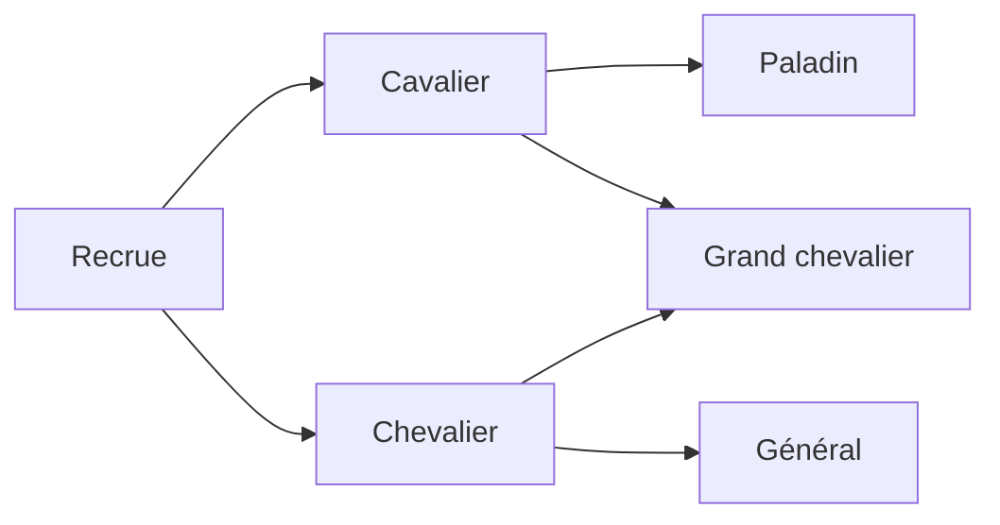

**Tactical Emblem — Compétences, promotions et règles de campagne**

Proposition de conception du 18 octobre 2026, complétée par un premier lot d'implémentation. Le détail de ce qui est livré figure à la fin du document ; le reste demeure une proposition. Les valeurs proposées sont des points de départ à tester, pas des règles universelles de Fire Emblem.

**1. Direction retenue**

Conserver la lisibilité du combat GBA, utiliser les promotions à embranchements de The Sacred Stones comme modèle de progression et emprunter aux épisodes suivants leurs outils de personnalisation. Les trois priorités doivent fonctionner ensemble : une promotion peut apprendre une compétence ; celle-ci peut empêcher une blessure mortelle ; les conditions du chapitre sont évaluées après cette résolution.

La recherche cible ces systèmes et leurs interactions. Elle ne constitue pas une extraction exhaustive des statistiques, scripts et contenus de tous les épisodes.

**2. Ce que les jeux apportent**

| Référence | Observation documentée | Application proposée |
|---|---|---|
| Genealogy of the Holy War | Certaines classes possèdent des compétences propres. | Distinguer les propriétés de la classe de celles du personnage. |
| The Sacred Stones | Promotions à branches, recrues et compétences de classes spécialisées. | Un arbre lisible avec des rôles différents selon la branche. |
| Path of Radiance | Les compétences ont des coûts de capacité variés. | Garder la possibilité future d'un budget de capacité, sans le rendre nécessaire en première version. |
| Awakening | Compétences apprises par niveau de classe, conservées après changement de classe ; cinq compétences actives au maximum. | Séparer compétences apprises et compétences équipées. |
| Fates | Une compétence personnelle fixe s'ajoute en plus des cinq emplacements d'autres compétences. | Donner une identité propre aux personnages. |
| Three Houses | Compétences de classe et récompenses de maîtrise ; techniques consommant de l'usure. | Prévoir des commandes actives et, plus tard, une maîtrise de classe facultative. |
| Engage | Héritage de compétences via les liens avec les Emblèmes et une dépense de points. | Extension possible pour des maîtres ou objets, après les trois priorités. |

Sources : [classes de FE4](https://serenesforest.net/genealogy-of-the-holy-war/classes/introduction/), [classes de FE8](https://serenesforest.net/the-sacred-stones/classes/introduction/), [compétences de FE9](https://serenesforest.net/path-of-radiance/miscellaneous/skills/), [compétences d'Awakening](https://serenesforest.net/awakening/miscellaneous/skills/), [compétences personnelles de Fates](https://serenesforest.net/fire-emblem-fates/other-characters/personal-skills/), [classes et maîtrise de Three Houses](https://serenesforest.net/three-houses/classes/class-abilities-arts/), [techniques de Three Houses](https://serenesforest.net/three-houses/miscellaneous/combat-arts/), [présentation officielle d'Engage](https://www.nintendo.com/ph/switch/ayfn/system/train.html).

Les effets portant le même nom changent selon l'épisode. Par exemple, Vantage est inconditionnel dans la table de Path of Radiance, mais soumis à un seuil de PV dans Awakening. Une compétence doit donc définir son effet et sa condition, pas seulement son nom.

**3. Compétences : modèle proposé**

Trois origines, indépendantes de la manière dont l'effet s'active :

- Personnelle : attachée au personnage, normalement non retirable.
- Intrinsèque à la classe : disponible tant que cette classe est utilisée.
- Apprise : acquise à un niveau défini ou par événement, puis conservée dans le répertoire du personnage.

Réglage retenu : une compétence personnelle fixe, en plus de cinq emplacements de compétences équipables. La personnelle ne consomme aucun de ces cinq emplacements. Les propriétés intrinsèques de classe restent distinctes et devront rester modestes pour limiter l'empilement.

Les ennemis et alliés utilisent le même système. L'éditeur peut ajouter une compétence à un placement particulier pour créer un boss distinct sans dupliquer toute sa classe. Un même identifiant de compétence accordé par plusieurs sources ne produit qu'un effet.

**Écrans à ajouter**

- Base de données → Compétences : nom, icône, description, activation, conditions, cible, portée, effets, limites et règles de cumul.
- Fiche personnage : compétence personnelle, compétences déjà apprises et équipement initial.
- Fiche classe : compétences intrinsèques et liste « niveau → compétence apprise ».
- Fiche ennemi : ajouts propres à ce placement, avec aperçu de la liste finale.
- En jeu : liste consultable sur toutes les unités ; changement d'équipement hors bataille ; annonce d'apprentissage et de déclenchement.

L'éditeur propose des formulaires : « si PV ≤ 50 % », « lorsque l'unité engage », « allié adjacent », « arme de type épée ». Les effets disponibles sont des opérations prises en charge par le moteur. Créer une compétence simple ne doit pas nécessiter d'écrire du JavaScript.

**Premier catalogue proposé — valeurs à équilibrer**

| Compétence | Effet proposé | Famille |
|---|---|---|
| Précision | +10 précision | Passive |
| Esquive | +10 esquive | Passive |
| Offensive | +3 dégâts si l'unité engage | Conditionnelle |
| Garde | −2 dégâts reçus si l'ennemi engage | Conditionnelle |
| Présence rassurante | Alliés adjacents : +10 esquive | Aura, sans cumul entre porteurs |
| Régénération | Récupère 10 % des PV max au début de sa phase | Début de phase |
| Luna | Chance = Tec ; ignore la moitié de Déf ou Rés applicable | Déclenchement offensif |
| Sol | Chance = Tec ; soigne de la moitié des PV réellement retirés | Déclenchement offensif |
| Vantage | À 50 % de PV ou moins, riposte avant le premier coup ennemi si la riposte est possible | Ordre des attaques |
| Miracle | Chance = Chance ; survit à 1 PV si les PV avant le coup étaient supérieurs à 1 | Survie |
| Ralliement | Consomme l'action pour donner +3 Force aux alliés adjacents jusqu'au début de la prochaine phase du lanceur | Commande |
| Percée | Attaque choisie : +4 puissance, coût total de 3 usages, sans doublé naturel | Technique |

Luna, Sol et Vantage s'inspirent des [compétences d'Awakening](https://serenesforest.net/awakening/miscellaneous/skills/). Miracle et les effets conditionnels ont aussi des références dans [Three Houses](https://serenesforest.net/three-houses/miscellaneous/abilities/). Les seuils et montants du tableau sont des propositions. Le premier lot peut se limiter aux dix premières compétences ; les commandes nécessitent ensuite la sélection de cibles et leur prise en charge par l'IA.

FE8 possède déjà des compétences spécifiques, notamment Great Shield, Sure Strike, Pierce, Pick et Summon. Elles montrent que les compétences sont compatibles avec une présentation GBA. Certaines exigent toutefois d'autres systèmes : Pick demande portes et coffres ; Summon demande création d'unités temporaires. [Référence FE8](https://serenesforest.net/the-sacred-stones/miscellaneous/skills/).

**Règles de résolution recommandées**

- Une aura identique utilise son effet le plus fort, pas la somme de tous ses porteurs.
- Un seul déclenchement offensif exclusif par coup en première version ; priorité explicite entre Luna, Sol et les attaques spéciales d'affinité existantes.
- Les effets défensifs compatibles peuvent intervenir ensuite. Les arrondis, plafonds et ordre des réductions sont définis une seule fois.
- Les seuils affectant l'ordre des attaques sont lus au début du combat ; les conditions propres à un coup utilisent l'état avant ce coup.
- Miracle s'applique avant de déclarer l'unité vaincue. Il ne donne pas de chance de survivre à un nouveau coup commencé à 1 PV.
- Une guérison liée aux dégâts utilise la perte réelle de PV : infliger théoriquement 40 dégâts à une cible qui n'a que 3 PV ne soigne pas sur 40.
- Les attaques duo suivent une règle explicite : pas de déclenchements offensifs supplémentaires dans le premier lot ; les protections de la cible restent applicables.
- Les dégâts de technique et leur coût sont montrés avant confirmation. Une arme sans assez d'usages ne permet pas la technique ; annuler ne consomme rien.
- La prévision montre les bonus certains et les chances de déclenchement séparément. Elle n'effectue aucun tirage aléatoire et ne promet pas l'activation de Luna ou Miracle.
- L'IA emploie les mêmes calculs que la prévision et la résolution, notamment pour Vantage et les auras.

Les compétences qui ajoutent plusieurs coups, réactivent une unité ou modifient le déplacement après une attaque demandent un lot ultérieur. Elles ne doivent pas être simulées par un simple bonus de dégâts.

**4. Promotions : un graphe de classes**

FE8 propose notamment Cavalier → Paladin ou Great Knight, et Knight → General ou Great Knight. Les recrues disposent d'un palier supplémentaire ; leur première promotion intervient après le niveau 10 au début d'une bataille suivante. Toutes les classes n'ont pas deux branches, notamment les seigneurs. [Arbres et exceptions de FE8](https://serenesforest.net/the-sacred-stones/classes/introduction/).

Exemple d'arbre à fournir dans le projet de démonstration :

L'éditeur doit autoriser un nombre libre de destinations et plusieurs paliers. Deux branches constituent un bon réglage de départ. Une classe finale peut avoir plusieurs origines ; elle ne doit pas être copiée pour chaque chemin.

**Données d'une transition**

- Classe de départ et d'arrivée.
- Niveau minimum, objet requis et éventuelle condition de scénario.
- Activation par objet, événement ou passage automatique au palier suivant.
- Bonus de statistiques propres à cette transition.
- Politique de niveau : remise à 1 par défaut pour le modèle proposé ; autre règle configurable.
- Compétences apprises à la promotion, si nécessaire.

Les gains doivent appartenir à la transition : atteindre la même classe depuis deux origines peut donner des gains différents. Les tables de FE8 décrivent ces gains par couple origine/destination. [Gains de promotion de FE8](https://serenesforest.net/the-sacred-stones/classes/promotion-gains/).

**Expérience du créateur et du joueur**

Dans la base, une vue Arbre affiche les classes et leurs liens. Un clic sur un lien ouvre ses conditions et bonus. Une vue Liste reste disponible pour modifier rapidement les données. Les prérequis invalides et cycles de promotions sont signalés ; les changements latéraux éventuels seront un système séparé.

En jeu, chaque destination présente son rôle, les gains, le déplacement, les armes accessibles, les plafonds et les compétences. Les branches indisponibles expliquent leur condition. Annuler laisse l'objet et l'unité intacts.

La promotion conserve les gains acquis, les objets et les compétences apprises. Elle change la classe, ses propriétés, les armes utilisables et l'apparence héritée. Pour les PV, proposition : conserver les PV manquants et ajouter le gain de PV max aux PV actuels, sans soin intégral implicite.

L'expérience doit tenir compte du palier ou d'un niveau effectif conservé : revenir au niveau affiché 1 ne doit pas transformer un vétéran en débutant pour les gains d'expérience. Les apprentissages déjà acquis ne sont pas accordés en double.

Pour conserver une identité GBA, les croissances du personnage resteraient inchangées par défaut. Une option future pourrait ajouter des croissances de classe. L'évolution des plafonds ne doit pas effacer silencieusement les statistiques acquises si un changement latéral vers une classe plus restrictive devient possible.

Un Grand chevalier peut être à la fois monté et blindé : séparer le profil de déplacement des catégories d'efficacité des armes. Le code actuel utilise essentiellement le type de déplacement pour cette efficacité ; ce point devient important avec les nouvelles branches.

**5. Mode de partie et sort des personnages**

Le choix Classique / Détente est présenté à la nouvelle partie, puis enregistré avec la campagne. Il est indépendant de la difficulté. En Détente, une unité vaincue revient lors d'une bataille ultérieure ; c'est bien la distinction décrite par Nintendo à propos du mode Casual. [Entretien officiel sur Awakening](https://iwataasks.nintendo.com/interviews/3ds/fire-emblem/0/2/).

| Situation proposée | Classique | Détente |
|---|---|---|
| Unité ordinaire à 0 PV | Retirée du combat, puis indisponible définitivement si la tentative est conservée | Retirée du combat, disponible au chapitre suivant |
| Personnage requis par l'objectif à 0 PV | Défaite du chapitre | Défaite du chapitre |
| Exception scénaristique « retrait » | Revient au chapitre suivant | Revient au chapitre suivant |
| Équipe entièrement hors combat | Défaite par défaut | Défaite par défaut |

La protection d'un personnage est définie dans le chapitre. Son devenir après sa chute est défini dans sa fiche, avec éventuellement une exception de chapitre : suivre le mode, revenir après la bataille, ou quitter définitivement l'équipe en restant vivant dans l'histoire. Une mort scénarisée doit être un événement explicite, distinct des règles normales du mode Détente.

Exemple : Lyn peut être obligatoire au chapitre 1, mais sa chute ne provoque plus de défaite au chapitre 2. En Classique elle peut alors être perdue définitivement. Un diplomate allié peut provoquer une défaite s'il tombe, sans être un Seigneur ni une unité contrôlable.

Classique ne doit pas imposer automatiquement une partie sans recommencement. La relance restaure l'état du début du chapitre. Une éventuelle option Ironman est séparée. Une sauvegarde de suspension peut mémoriser la tentative en cours ; les morts sont validées dans la progression de campagne lorsque le joueur conserve le résultat du chapitre.

Les dialogues distinguent « vaincu », « retiré » et « mort ». Un personnage présent dans les scènes mais définitivement retiré du combat n'est pas interchangeable avec un mort. Le devenir des objets doit aussi être explicite : proposition initiale, inventaire conservé en Détente, perdu en cas de mort définitive, exception configurable pour les objets de quête.

**6. Victoire et défaite configurables par chapitre**

Remplacer le choix d'un seul objectif par des conditions combinables, tout en proposant des modèles prêts à remplir.

| Victoire | Paramètres |
|---|---|
| Déroute | Groupe d'ennemis concerné ; renforts bloquants ou non |
| Vaincre une cible | Une ou plusieurs unités identifiées |
| Prendre un point | Case ou zone ; personnages autorisés |
| Survivre | Nombre de tours complets |
| Défendre | Zone à protéger et durée |
| Évacuer | Unités qui doivent atteindre une sortie |
| Escorter | Personnage et destination |
| Scénario | Drapeau posé par un événement |

Défaites proposées : personnage sélectionné vaincu, équipe neutralisée, ennemi entré dans une zone protégée, cible ayant fui, limite de tours dépassée, nombre de pertes dépassé, événement de scénario.

Le formulaire permet « toutes ces conditions » et « au moins une ». Par exemple : vaincre le commandant OU tenir huit tours ; vaincre le commandant ET faire atteindre la sortie au diplomate. La défaite peut dépendre de n'importe lequel des héros sélectionnés, ou d'un seuil dans un groupe. L'état de chaque condition est visible en jeu.

Une combinaison n'est pas étrangère à FE8 : le chapitre 13 de la route d'Eirika propose de survivre onze tours ou de vaincre Aias. [Guide du chapitre](https://serenesforest.net/the-sacred-stones/general/chapter-guide/main-story/chapter-9-chapter-14-eirika/).

**Cas à définir dès le départ**

- « Survivre huit tours » signifie achever huit cycles de phases, avec un libellé précis dans l'éditeur.
- Un héros obligatoire déjà mort dans la campagne ne doit pas être réapparu automatiquement. L'éditeur signale le risque ; le scénario doit prévoir une substitution, une autre branche ou un échec explicite.
- Un objectif visant une unité inexistante est une erreur de validation, pas une victoire gratuite.
- Les renforts facultatifs ne doivent pas empêcher une déroute de se terminer indéfiniment.
- Une unité évacuée reste vivante et ne compte pas comme une perte. Cela doit être distingué d'une équipe entièrement vaincue.
- Après un coup et ses protections, une unité à 0 PV est retirée de la séquence ; la fin de mission se traite avant de laisser jouer d'autres actions. Après les événements associés, un arbitre unique décide du résultat.
- Si victoire et défaite sont vraies au même point d'évaluation, la défaite a priorité par défaut. Une règle de scénario explicite peut prendre le contrôle pour un sacrifice final voulu.
- Séparer « peut prendre le point », « personnage principal » et « doit survivre ». Aucun de ces attributs ne doit découler automatiquement des deux autres.

**7. Conséquences pour le projet actuel**

Constats issus du code local avant le premier lot (conservés pour expliquer les changements) :

- `src/shared/rules.js` fournit déjà prévisions, résolution, hasard injectable et expérience : base utile pour les compétences.
- `src/renderer/db.js` ne propose qu'une destination `promotesTo` et deux paliers. Il faut des transitions multiples et la vue d'arbre.
- `src/renderer/playtest.js` contrôle la défaite avec `isLord` et la présence de joueurs vivants. La prise de point et la survie terminent aussi directement le chapitre : toutes les issues devront passer par la même évaluation.
- `saveCampaign()` conserve niveaux, statistiques et inventaires, mais pas la classe. Ajouter une promotion sans modifier cette transmission ferait perdre une partie de son état au chapitre suivant.
- La campagne reste en mémoire. La sélection du mode, le roster complet, les classes, compétences, morts/retraits, soutiens, convoi et variables de scénario doivent appartenir à un état de campagne persistant séparé du projet d'édition.
- Les morts d'alliés ne suivent pas actuellement le même chemin de persistance que celles du joueur. La politique de campagne doit couvrir les personnages persistants des deux équipes.

Découpage recommandé : règles de compétences, promotions, objectifs et campagne dans des modules indépendants de l'interface. Une description de compétence doit être validée ; le moteur ne doit pas exécuter de formules textuelles arbitraires.

Compatibilité : convertir l'ancienne destination en une transition ; convertir l'ancien objectif en condition unique ; déduire initialement les personnages requis des anciens Seigneurs pour conserver le comportement ; attribuer des listes de compétences vides aux anciennes données. Versionner cette migration et préserver une copie du projet avant réécriture.

**8. Ordre de réalisation et preuves attendues**

| Lot | Résultat jouable | Vérifications essentielles |
|---|---|---|
| A — Conditions et modes | Choix de mode, personnages requis, objectifs simples et combinés, état de campagne conservé | Même chapitre dans les deux modes ; héros requis ; allié à protéger ; tour limite ; reprise après défaite ; sauvegarde/rechargement |
| B — Compétences | Édition, attribution, apprentissage, prévisions, animations et IA pour le catalogue initial | Hasard fixé ; seuils exacts ; absence de cumul ; arme cassée ; soin plafonné ; Miracle ; attaque duo |
| C — Promotions | Arbre, choix en jeu, objets, bonus et compétences, transmission entre chapitres | Annulation sans consommation ; branche verrouillée ; classe partagée ; conservation des acquis ; apprentissage unique ; rechargement |
| D — Commandes et variantes | Ralliement, techniques et comportements avancés retenus après essais | Cibles et coûts légaux ; prise en charge IA ; fin de mission pendant une action composée |

Les structures des promotions et compétences doivent être conçues ensemble avant le lot A, même si leurs interfaces sont livrées ensuite. La sauvegarde minimale de campagne est une dépendance de ces priorités, pas une diversion vers une nouvelle fonctionnalité majeure.

Scénario d'acceptation : une carte avec un héros requis, un diplomate à escorter, un allié sacrifiable, un boss avec une compétence visible et une unité ayant deux promotions. La terminer en Classique et en Détente, passer au chapitre suivant, fermer puis recharger. Vérifier classes, apprentissages, inventaires, pertes et conditions.

**9. Extensions compatibles à garder après ce socle**

Les techniques à coût d'usure s'intègrent naturellement à l'inventaire existant. Le déplacement après action, la maîtrise de classe, les rangs d'armes et les compétences obtenues via des maîtres peuvent enrichir les choix ensuite. Le retour en arrière pendant une bataille nécessite un historique complet de l'état et du hasard ; il mérite un chantier séparé.

Je reporterais les systèmes de générations, de bataillons et d'Emblèmes complets : chacun transforme fortement les règles et l'équilibrage. L'objectif immédiat est de rendre les trois priorités configurables et fiables dans un petit jeu complet.

**10. Premier lot livré — conditions, modes et campagne**

- Choix Classique / Détente à la nouvelle partie et reprise d'une campagne sauvegardée.
- Personnages requis par chapitre, incluant les alliés ; sélection vide possible pour autoriser la chute des anciens Seigneurs.
- Autorisation de prendre un point indépendante du statut Seigneur.
- Objectif principal et conditions supplémentaires combinées par ET / OU : déroute, boss, cible précise (condition supplémentaire), prise de point et survie.
- Défaite par équipe vaincue, nombre de pertes, limite de tours ou ennemi dans une zone.
- Exception individuelle de retraite : retour au chapitre suivant, même en Classique.
- Sauvegarde manuelle du début du chapitre dans `saves/campaign.json`, avec copie de secours `.bak`. Il ne s'agit pas d'une suspension au milieu du combat. Une nouvelle partie ne remplace pas la sauvegarde sans action de sauvegarde explicite.
- Recommencer restaure le chapitre courant, la campagne, le convoi et les soutiens tels qu'ils étaient à son début.
- Conservation de la classe et du déplacement entre chapitres, avec des champs de persistance prêts pour les compétences futures.
- Anciens chapitres : les protections et autorisations héritent des Seigneurs tant que le créateur ne les personnalise pas. Les configurations impossibles sont signalées avant le test, notamment un objectif de boss sans boss.

Les compétences jouables (personnelle fixe + cinq équipables), leurs écrans et les promotions à branches constituent les deux prochains lots. L'évacuation, l'escorte, les conditions par variables de scénario et la suspension en milieu de bataille restent également à réaliser. La sélection des renforts bloquants n'a pas encore de contrôle dédié dans l'éditeur.

**11. Deuxième lot — catalogue de compétences**

L'onglet Compétences de la base permet de créer, dupliquer et supprimer des fiches. Chaque fiche comprend un nom, un symbole, une description libre et des paramètres structurés : effet, valeur, probabilité fixe ou liée à Technique / Chance, engagement du combat, type d'arme, seuil de PV, adjacence et rayon pour l'aura. Le résumé suit les réglages ; les erreurs sont signalées et empêchent une sauvegarde invalide.

Dix exemples sont proposés : Précision, Esquive, Offensive, Garde, Présence rassurante, Régénération, Luna, Sol, Vantage et Miracle. Les nouveaux projets reçoivent le catalogue. Les anciens s'ouvrent avec un catalogue vide et peuvent ajouter les exemples manquants sans remplacer leurs fiches existantes. Les données se trouvent dans `data/skills.json` ; un fichier illisible est signalé explicitement.

Ce lot concerne l'édition du catalogue. Les lots suivants ajoutent l'attribution, les apprentissages et les effets en jeu décrits ci-dessous.

**12. Troisième lot — attribution aux personnages**

La fiche Unités contient une personnelle fixe (hors quota), le répertoire des compétences déjà apprises et cinq emplacements équipables. Les emplacements proposent uniquement les compétences apprises, avec exclusion de la personnelle et des doublons. Une compétence retirée du répertoire est automatiquement déséquipée. Si la nouvelle personnelle occupait un emplacement, celui-ci est libéré.

Les compétences sont attribuées par le créateur avant le test. Les personnages du joueur et les personnages alliés reçoivent la même attribution. En jeu, un bouton de consultation présente la personnelle, les cinq emplacements et les compétences apprises non équipées. Cette consultation ne permet pas de modifier la personnelle ou l'équipement pendant la bataille.

Les attributions sont sauvegardées dans les fiches des unités et transmises entre chapitres, puis conservées dans les sauvegardes de campagne. Les anciennes fiches et anciennes sauvegardes sans ces champs restent prises en charge. La suppression d'une compétence du catalogue est bloquée tant qu'un personnage la référence ; une sauvegarde de projet avec référence manquante ou équipement invalide est refusée avant écriture.

L'apprentissage automatique est ajouté par le quatrième lot ci-dessous. Les effets en combat sont désormais décrits dans la section 15.

**13. Quatrième lot — apprentissage par classe et par niveau**

La fiche de chaque classe permet d'ajouter, modifier et retirer des paliers « niveau → compétence ». Plusieurs compétences peuvent arriver au même niveau. Une même compétence ne peut être programmée qu'une fois par classe. Les références manquantes, niveaux invalides et doublons sont signalés ; les paliers au-delà du niveau maximum du projet affichent un avertissement.

Chaque montée de niveau acquiert automatiquement les compétences atteintes qui ne sont pas déjà connues. Les annonces suivent les montées de niveau, dans l'ordre. Une place libre équipe la nouvelle compétence ; sinon un choix propose de remplacer un des cinq emplacements ou de conserver la nouvelle compétence dans le répertoire. Fermer ce choix ou appuyer sur Échap conserve également l'apprentissage sans changer l'équipement. La personnelle reste fixe, et la compétence remplacée n'est jamais oubliée.

Les unités créées à un niveau élevé connaissent déjà les compétences de leur classe dont le seuil est atteint. La fiche de personnage prévisualise ces acquis, marqués « classe ». Les choix d'équipement explicites sont respectés ; en leur absence, les premiers acquis de classe occupent jusqu'à cinq places. Les ennemis suivent aussi les paliers de leur classe. Les anciennes sauvegardes bénéficient d'un rattrapage des acquis manquants sans remplir de force les emplacements.

Les apprentissages sont conservés entre chapitres et dans les sauvegardes, y compris les compétences laissées dans le répertoire. Elles ne sont pas réannoncées ni rééquipées au chapitre suivant. Les programmes sont enregistrés dans les fiches de classe ; la suppression d'une compétence référencée par un programme est bloquée.

**14. Complément — apprentissages propres aux personnages**

Chaque fiche Unités propose un programme « niveau → compétence » propre au personnage, dans « Apprentissages propres au personnage ». Il s’ajoute au programme de la classe actuelle. Les niveaux correspondent au niveau affiché de l’unité. Si les deux programmes enseignent une même compétence, le premier palier atteint l’accorde ; elle n’est jamais annoncée ou ajoutée une seconde fois. La personnelle fixe reste indépendante et ne consomme aucun des cinq emplacements.

Les compétences futures ne deviennent pas disponibles avant leur palier. Les unités créées à un niveau élevé reçoivent les acquis des deux programmes. Les personnages alliés utilisent également leur programme propre, tandis que les ennemis génériques suivent celui de leur classe. La restauration de campagne conserve les acquis et les choix d’équipement, avec rattrapage des paliers manquants sans équipement forcé.

La section « Compétences déjà acquises au départ » explicite les dons immédiats du créateur. Les anciennes attributions restent conservées ; elles ne sont pas converties automatiquement en apprentissages futurs. Les programmes de personnage sont facultatifs, enregistrés dans `data/units.json`, validés avant toute écriture et pris en compte dans la protection contre la suppression des compétences utilisées.

**15. Cinquième lot — effets des dix compétences en jeu**

La personnelle et les cinq compétences équipées appliquent leurs effets. Les compétences en réserve restent inactives. Les conditions d’engagement du combat, d’arme du porteur, de PV et d’allié adjacent sont partagées par la prévision et la résolution. Les seuils de PV sont inclusifs et relus avant chaque coup ; Vantage et les doublés sont déterminés au début du combat.

Les bonus distincts de précision, esquive et dégâts se cumulent. Garde retire sa valeur après le multiplicateur critique, avec un minimum de zéro dégât. Les auras d’esquive ne s’ajoutent pas entre elles : la plus forte protège les autres alliés vivants dans son rayon de Manhattan, y compris les unités vertes. Les morts et renforts non déployés n’émettent pas d’aura. Régénération rend au moins 1 PV par effet, avec arrondi inférieur et plafond des PV maximum, au début de la phase du porteur et avant le terrain. Elle ne ressuscite pas.

Les probabilités fixes, Technique et Chance sont plafonnées entre 0 et 100 %. Les déclenchements offensifs sont exclusifs : attaque spéciale d’affinité, puis Luna, puis Sol ; dans une même famille, ordre de la personnelle puis des emplacements. En cas d’échec, l’effet suivant peut être essayé. Luna ignore une proportion de la protection applicable (Défense ou Résistance + terrain), arrondie à l’inférieur. Sol soigne sur les PV réellement retirés, après Miracle, avec arrondi inférieur et plafond de soin. Un coup raté ne déclenche ni Luna ni Sol.

Vantage déplace la première riposte avant le premier coup ennemi sans ajouter de coup ; sans arme utilisable à la distance du combat, il ne s’applique pas. Miracle intervient sur un coup mortel si les PV avant le coup étaient supérieurs à 1. Le coup suivant peut donc achever le porteur. Les coups cessent dès qu’un combattant est vaincu. Une arme brisée supprime les frappes suivantes avec cette arme ; elle ne permet pas d’utiliser automatiquement l’objet suivant pendant ce combat. Les attaques duo reçoivent les passifs, Garde et Miracle, mais ne déclenchent ni Luna ni Sol du partenaire.

La prévision ne consomme aucun hasard. Elle affiche les dégâts hors déclenchements, les passifs actifs, les chances de Luna/Sol/Miracle, la variante de dégâts de Luna et la priorité de Vantage. L’IA utilise ces mêmes calculs pour son estimation de dégâts, de soin et de survie, en tenant compte de l’ordre des coups ; son score reste une estimation, pas une simulation exhaustive de toutes les branches et changements de conditions de PV. Les déclenchements sont annoncés et les PV soignés actualisés dans la scène animée comme sur la map.

Les programmes d’apprentissage des classes et des personnages restent à définir par le créateur dans son projet.

**16. Promotions à embranchements — livrées**

Les classes proposent plusieurs transitions avec conditions, objet requis, bonus et compétences accordées. L'arbre d'évolution, la comparaison des destinations et les raisons de verrouillage sont consultables en jeu. Une confirmation applique la promotion et consomme le sceau ; annuler conserve l'état de départ. La classe, le niveau effectif, les gains et les apprentissages sont conservés entre les actes et dans les sauvegardes.

**17. Gestion de l'équipe au camp — livrée**

Le menu Équipe distingue l'effectif recruté des PNJ dessinés dans le camp. Les réservistes sont accessibles même s'ils n'ont aucun placement sur cette map. L'éditeur règle l'équipe de départ dans Lobby et les recrutements après un acte ou un chapitre dans les fiches Unités. Les placements joueur recrutent au début de leur acte ; un PNJ du camp ne suffit pas. Les anciennes sauvegardes sont prises en charge, et les morts définitives restent exclues de l'équipe disponible.

Chaque personnage peut équiper cinq compétences déjà apprises en plus de sa personnelle fixe. Retirer une compétence la conserve dans le répertoire. Les objets circulent entre tous les recrutés et le convoi en conservant leurs usages ; une destination pleine propose un échange. L'ordre d'inventaire peut être changé pour choisir la première arme utilisable. Les promotions sont également accessibles au camp, avec les mêmes conditions et bonus qu'en bataille, sans consommer de tour. La boutique peut fournir les réservistes.

La sauvegarde au camp conserve l'ensemble de l'effectif, ses compétences et son équipement. Un scénario automatisé vérifie les échanges avec inventaires pleins, l'annulation, la promotion d'un réserviste, la sauvegarde réelle, son rechargement, le déploiement et un recrutement après victoire.

**18. Écran de préparation avant bataille — livré**

Les actes ouvrent des préparatifs avant leurs dialogues de début et leur premier tour, y compris lors d'un enchaînement d'actes ou dans une campagne sans lobby. L'effectif recruté et vivant fournit les participants possibles ; les unités vertes de l'acte restent fixes. La limite et les personnages imposés se règlent dans l'éditeur. Les personnages à protéger sont automatiquement imposés, et une prise de point obligatoire exige un participant ou un allié fixe autorisé. Un personnage requis mort définitivement bloque le départ avec une explication.

Les placements joueur définissent les cases disponibles et la sélection recommandée. Le joueur peut remplacer un participant par un réserviste, consulter ses caractéristiques et échanger ses positions sur l'aperçu de la map ou via les boutons de cases. Les terrains sont contrôlés selon la classe actuelle, notamment après une promotion. Les positions sont propres à la campagne ; les données de placement du projet restent intactes. Le choix peut être désactivé pour un acte entièrement scénarisé.

Les cinq emplacements de sauvegarde conservent la sélection et les positions. Une reprise ou un recommencement rouvre les préparatifs ; un déploiement devenu incompatible avec le projet est réajusté avec une annonce. Le retour au camp permet de reprendre les équipements et promotions dans le menu Équipe. Les équipements sont consultables, mais ne se modifient pas directement dans ce nouvel écran.

Les tests couvrent les contraintes de sélection, les cases et types de mouvement, les sauvegardes et leur compatibilité. Un scénario en jeu vérifie le parcours jusqu'à la bataille, le chargement depuis les paramètres, l'acte suivant, une petite fenêtre et la désactivation des préparatifs.

**19. Villages à visiter — livrés**

L'éditeur permet de placer, déplacer et supprimer les villages sur la map en mode Unités, avec annulation. La fiche de village et la fiche d'acte partagent les réglages : dialogue, or, arme ou objet et utilisations, recrutement, visiteurs autorisés et répétition lors d'un acte rejoué. Les références utilisées empêchent la suppression accidentelle de leurs personnages et récompenses ; les données invalides sont refusées avant écriture.

L'action Visiter apparaît pour un personnage du joueur sur la case et consomme son action. Les objets utilisent l'inventaire puis le convoi ; une saturation complète bloque la visite sans rien perdre. Une nouvelle recrue rejoint le terrain à proximité sur une case accessible, ou un allié vert présent passe au joueur en gardant ses PV et son équipement. Les recrues peuvent agir immédiatement. Les doublons et résurrections sont exclus ; sans place pour une nouvelle recrue, le village reste disponible.

L'historique des visites appartient à la campagne, avec une seule récompense par défaut, même après rejeu. Une option autorise une récompense par nouvelle tentative rejouée après victoire. Le point de reprise de début d'acte garantit que recommencer ou abandonner annule ensemble les visites et leurs gains. Les anciennes sauvegardes sans historique restent prises en charge. Le prologue des nouveaux projets d'exemple comporte un village.

**20. Coffres, portes et Crochetage — livrés**

Les interactions de la map et la fiche d'acte permettent de placer et de configurer les coffres et portes, avec déplacement, suppression et annulation. Les réglages comprennent le dialogue, les personnages autorisés, le verrouillage, la clé précise facultative et l'autorisation de Crochetage. Les coffres définissent l'or, l'arme ou l'objet offert et ses utilisations ; les portes définissent le terrain du passage une fois ouvertes. Les références et positions sont validées avant écriture, et les fiches utilisées sont protégées contre la suppression.

Le personnage doit être sur le coffre ou adjacent à la porte. L'ouverture consomme son action et une utilisation d'une clé adaptée dans son inventaire. Crochetage personnelle ou équipée est prioritaire et évite cette consommation ; une compétence connue mais en réserve ne suffit pas. Les nouveaux projets proposent un Voleur qui l'apprend au niveau 1, ainsi que les clés de coffre et de porte dans les objets et la boutique du camp. Les anciens projets disposent de boutons pour ajouter les clés et compétences d'exemple manquantes sans écraser leurs réglages.

Un inventaire plein envoie la récompense au convoi. Si les deux sont pleins, aucune ouverture ni consommation partielle n'a lieu ; une clé épuisée peut libérer une place pour la récompense. Les portes fermées bloquent tous les types de déplacement et l'IA. Une porte ouverte utilise le terrain choisi pour les chemins, bonus et soins ; la map du projet reste intacte.

Les coffres sont pillés une seule fois par campagne, avec une option de remplissage lors d'un acte rejoué après victoire. Les portes se referment à chaque tentative. Recommencer et abandonner annulent ensemble les clés utilisées, les ouvertures et les récompenses. Les anciens actes et sauvegardes sans ces interactions restent pris en charge. Les tests couvrent les règles, l'édition, Crochetage, les inventaires pleins, les passages, la reprise et la persistance après victoire ; le parcours des villages reste vérifié séparément.

**21. Échanges d'objets en bataille — livrés**

L'action Échanger propose les personnages du joueur vivants et adjacents après le déplacement. Un partenaire ayant déjà joué reste accessible ; les alliés verts, ennemis et réservistes sont exclus. L'écran présente les deux inventaires, leurs cinq places, les utilisations et l'arme équipée. Un objet peut être donné dans une place libre ou échangé contre un objet de l'autre inventaire, même plein. Les armes inutilisables par la classe restent transférables et sont signalées. La souris, les flèches, Z / Entrée et X / Échap permettent l'ensemble du parcours.

Un transfert valide le déplacement de l'initiateur, qui peut encore attaquer, soigner, utiliser un objet ou attendre. Le partenaire garde son état de tour ; un personnage ayant joué n'est pas réactivé. Fermer sans transfert permet d'annuler le déplacement. Après transfert, fermer l'écran conserve les objets échangés et empêche de revenir à la case d'origine. La première arme utilisable et les possibilités d'attaque sont recalculées après chaque changement d'inventaire. Le verrou de déplacement est temporaire et disparaît au tour suivant.

Les échanges conservent les utilisations et le nombre total d'objets. Les actions invalides ne modifient rien. Recommencer restaure les inventaires du début d'acte, tandis qu'une victoire et la sauvegarde de campagne conservent les transferts sans conserver le verrou de tour. Les tests vérifient les conditions, les inventaires pleins, l'équipement, l'annulation, l'attaque immédiate avec une arme reçue, le tour suivant et la sauvegarde/reprise. Le scénario en jeu vérifie également plusieurs partenaires, un inventaire vide et une petite fenêtre.

**22. Événements à actions et choix mémorisés — livrés**

La fiche d'acte permet de nommer, dupliquer et ordonner les événements, puis d'ajouter et de réordonner leurs actions. Les dialogues existants restent compatibles et précèdent les nouvelles actions. Les déclencheurs historiques (début, tour, unité vaincue, zone et victoire) sont complétés par l'ouverture d'un coffre ou d'une porte, la visite d'un village et l'activation de conditions. Ces conditions peuvent exiger des personnages vivants et déployés et des informations vraies/fausses mémorisées dans la campagne. Les réservistes sont exclus du contrôle de présence.

Les actions comprennent les dialogues, récompenses d'or et d'orbes, armes/objets avec utilisations et destinataire, renforts placés, portes ouvertes/fermées, remplacement de l'objectif, informations mémorisées et choix entre deux réponses. Les événements conditionnels peuvent former des branches à partir d'un choix. Une information absente vaut faux. Les conditions sont réévaluées après les événements et actions, avant le résultat de mission ; celles d'un début de tour passent après les événements de ce tour. Un événement conditionnel répétable ne rejoue qu'après une transition de faux à vrai.

Les renforts peuvent être marqués « Arrivée uniquement par événement » en F3. Ils attendent le déclenchement choisi, apparaissent sur une case accessible proche si nécessaire et ne sont pas dupliqués. Les objectifs qui incluent les renforts continuent de les compter. Les fermetures de porte attendent si leur case est occupée. Les changements de passage actualisent les déplacements et la menace. Un nouvel objectif remplace les objectifs de victoire en conservant les défaites et protections ; une survie compte le nombre de tours demandé à partir du tour courant, inclus. Pour une future prise de point, le créateur doit prévoir un participant autorisé, éventuellement imposé dans les préparatifs.

Les récompenses respectent les capacités des inventaires et du convoi. Une séquence bloquée attend puis reprend à l'action concernée, sans rejouer le dialogue ni redistribuer les récompenses précédentes. La victoire attend qu'une séquence en cours, y compris une récompense de victoire, soit terminée ; les échanges ou le convoi permettent de libérer la place. Une séquence et les chaînes de conditions sont bornées à une exécution de chaque événement par étape pour éviter les boucles immédiates.

La fréquence se règle par tentative, par déclenchement ou une fois dans toute la campagne. Les informations et l'historique de campagne sont sauvegardés après victoire et repris par les actes suivants. Recommencer ou abandonner restaure la mémoire et les gains du début d'acte. Les portes et objectifs sont modifiés dans une copie locale de l'acte et ne changent jamais le projet. Les sauvegardes de bataille restent des débuts d'acte ; la suspension de séquence n'est pas ajoutée.

Les tests couvrent les déclencheurs, branches, fréquences, attentes et reprises, objectifs, renforts, objets, références et mémoire de sauvegarde. Un scénario automatisé crée les événements via l'éditeur et vérifie le choix, le coffre, une récompense bloquée puis débloquée par échange, une embuscade, la fermeture d'une porte, cinq tours de survie, une récompense de victoire en attente, le recommencement et le rejeu après sauvegarde. Les parcours des coffres/portes et échanges restent vérifiés séparément.

**23. Altérations Poison, Sommeil et Silence — livrées**

Le premier lot ajoute trois effets tactiques distincts. Poison retire au début de la phase du porteur 10 % de ses PV maximum, arrondis au supérieur, sans l'achever. Sommeil empêche déplacement, action, riposte et participation offensive aux duos ; les coups reçus ne réveillent pas. Silence interdit tomes, armes magiques et bâtons, mais laisse les armes physiques, objets et déplacements. Les passifs défensifs restent applicables. Les statuts différents coexistent, et un même statut ne cumule pas ses effets : une durée supérieure prolonge la durée restante.

Les durées de 1 à 9 se comptent en phases du porteur, avec activation au début et diminution à la fin. Une application en cours de phase agit tout de suite mais commence son décompte à la prochaine phase complète. Les phases du joueur, des alliés et des ennemis suivent les mêmes règles. Le poison passe avant les soins de terrain et de Régénération. Les personnages endormis peuvent passer leurs phases via Fin du tour. Le sommeil supprime la menace et les actions de l'IA ; le silence retire les armes interdites et peut laisser une arme physique de secours.

L'éditeur règle l'effet, la chance après un coup réussi et la durée sur chaque arme offensive. Un effet de compétence dédié reprend les conditions existantes et les chances fixes, Technique ou Chance ; la personnelle et les cinq emplacements restent inchangés. Les réserves ne s'activent pas. Les conditions sont lues avant le coup, même si Sol soigne ensuite le porteur. L'altération s'ajoute aux effets offensifs existants, sans leur ajouter de bonus de stats ou de critique. Elle exige un coup réussi et une cible survivante, même à zéro dégât ; ratés, victimes vaincues et overkill sont exclus. Sommeil et Silence peuvent interrompre les coups restants du combat. Les prévisions affichent les chances et durées, et préviennent de cette interruption possible ; l'évaluation des altérations par l'IA reste une estimation.

Les objets peuvent guérir un statut précis ou tous les statuts du porteur, et sont inutilisables si rien n'est à soigner. Un bâton de rétablissement cible les alliés atteints même à tous leurs PV. Plusieurs bâtons utilisables sur une même cible donnent un choix explicite entre soin de PV et rétablissement. Le soin ne réactive pas une action dépensée ; un personnage réveillé qui n'avait pas joué peut agir. Un personnage endormi ne peut pas se soigner lui-même, et Silence bloque le bâton du soigneur.

Les onglets Armes, Objets et Compétences proposent l'ajout des exemples manquants sans remplacer les fiches existantes : épée empoisonnée, Rétablissement, Antidote, Remède universel et trois compétences d'altération. Les événements peuvent appliquer ou soigner un statut sur un personnage déployé ou un ennemi déjà apparu. Les statuts sont affichés sur la map et dans la fiche d'unité, avec durée et explication. Ils sont annoncés dans les combats animés comme sur la map. Ils ne sont pas enregistrés dans l'état permanent des personnages et disparaissent au camp ou à l'acte suivant ; recommencer rejoue les éventuels statuts scénarisés de départ.

Les tests couvrent les durées, renouvellements, poison non létal, restrictions, interactions de combat et compétences, soins, événements, validation avant écriture et compatibilité des sauvegardes. Un scénario complet vérifie l'édition, les trois effets, objets de soin, choix de bâton, interruption de riposte, combats animés et sur la map, expiration et recommencement.

Le recrutement par conversation est reporté : les invocations constituent le mode de recrutement principal souhaité. Les bonus supplémentaires de stats et de critique ne sont pas prioritaires ; ce lot enrichit les effets tactiques.
