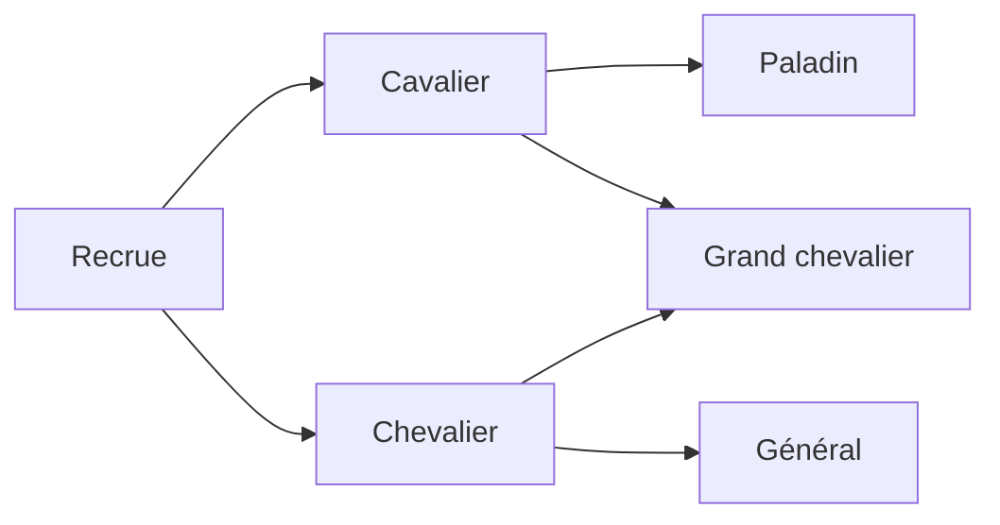

**Tactics Forge — Compétences, promotions et règles de campagne**

Proposition de conception du 18 octobre 2026, complétée par un premier lot d'implémentation. Le détail de ce qui est livré figure à la fin du document ; le reste demeure une proposition. Les valeurs proposées sont des points de départ à tester, pas des règles universelles de Fire Emblem.

**1. Direction retenue**

Conserver la lisibilité du combat GBA, utiliser les promotions à embranchements de The Sacred Stones comme modèle de progression et emprunter aux épisodes suivants leurs outils de personnalisation. Les trois priorités doivent fonctionner ensemble : une promotion peut apprendre une compétence ; celle-ci peut empêcher une blessure mortelle ; les conditions du chapitre sont évaluées après cette résolution.

La recherche cible ces systèmes et leurs interactions. Elle ne constitue pas une extraction exhaustive des statistiques, scripts et contenus de tous les épisodes.

**2. Ce que les jeux apportent**

| Référence | Observation documentée | Application proposée |
|---|---|---|
| Genealogy of the Holy War | Certaines classes possèdent des compétences propres. | Distinguer les propriétés de la classe de celles du personnage. |
| The Sacred Stones | Promotions à branches, recrues et compétences de classes spécialisées. | Un arbre lisible avec des rôles différents selon la branche. |
| Path of Radiance | Les compétences ont des coûts de capacité variés. | Garder la possibilité future d'un budget de capacité, sans le rendre nécessaire en première version. |
| Awakening | Compétences apprises par niveau de classe, conservées après changement de classe ; cinq compétences actives au maximum. | Séparer compétences apprises et compétences équipées. |
| Fates | Une compétence personnelle fixe s'ajoute en plus des cinq emplacements d'autres compétences. | Donner une identité propre aux personnages. |
| Three Houses | Compétences de classe et récompenses de maîtrise ; techniques consommant de l'usure. | Prévoir des commandes actives et, plus tard, une maîtrise de classe facultative. |
| Engage | Héritage de compétences via les liens avec les Emblèmes et une dépense de points. | Extension possible pour des maîtres ou objets, après les trois priorités. |

Sources : [classes de FE4](https://serenesforest.net/genealogy-of-the-holy-war/classes/introduction/), [classes de FE8](https://serenesforest.net/the-sacred-stones/classes/introduction/), [compétences de FE9](https://serenesforest.net/path-of-radiance/miscellaneous/skills/), [compétences d'Awakening](https://serenesforest.net/awakening/miscellaneous/skills/), [compétences personnelles de Fates](https://serenesforest.net/fire-emblem-fates/other-characters/personal-skills/), [classes et maîtrise de Three Houses](https://serenesforest.net/three-houses/classes/class-abilities-arts/), [techniques de Three Houses](https://serenesforest.net/three-houses/miscellaneous/combat-arts/), [présentation officielle d'Engage](https://www.nintendo.com/ph/switch/ayfn/system/train.html).

Les effets portant le même nom changent selon l'épisode. Par exemple, Vantage est inconditionnel dans la table de Path of Radiance, mais soumis à un seuil de PV dans Awakening. Une compétence doit donc définir son effet et sa condition, pas seulement son nom.

**3. Compétences : modèle proposé**

Trois origines, indépendantes de la manière dont l'effet s'active :

- Personnelle : attachée au personnage, normalement non retirable.
- Intrinsèque à la classe : disponible tant que cette classe est utilisée.
- Apprise : acquise à un niveau défini ou par événement, puis conservée dans le répertoire du personnage.

Réglage retenu : une compétence personnelle fixe, en plus de cinq emplacements de compétences équipables. La personnelle ne consomme aucun de ces cinq emplacements. Les propriétés intrinsèques de classe restent distinctes et devront rester modestes pour limiter l'empilement.

Les ennemis et alliés utilisent le même système. L'éditeur peut ajouter une compétence à un placement particulier pour créer un boss distinct sans dupliquer toute sa classe. Un même identifiant de compétence accordé par plusieurs sources ne produit qu'un effet.

**Écrans à ajouter**

- Base de données → Compétences : nom, icône, description, activation, conditions, cible, portée, effets, limites et règles de cumul.
- Fiche personnage : compétence personnelle, compétences déjà apprises et équipement initial.
- Fiche classe : compétences intrinsèques et liste « niveau → compétence apprise ».
- Fiche ennemi : ajouts propres à ce placement, avec aperçu de la liste finale.
- En jeu : liste consultable sur toutes les unités ; changement d'équipement hors bataille ; annonce d'apprentissage et de déclenchement.

L'éditeur propose des formulaires : « si PV ≤ 50 % », « lorsque l'unité engage », « allié adjacent », « arme de type épée ». Les effets disponibles sont des opérations prises en charge par le moteur. Créer une compétence simple ne doit pas nécessiter d'écrire du JavaScript.

**Premier catalogue proposé — valeurs à équilibrer**

| Compétence | Effet proposé | Famille |
|---|---|---|
| Précision | +10 précision | Passive |
| Esquive | +10 esquive | Passive |
| Offensive | +3 dégâts si l'unité engage | Conditionnelle |
| Garde | −2 dégâts reçus si l'ennemi engage | Conditionnelle |
| Présence rassurante | Alliés adjacents : +10 esquive | Aura, sans cumul entre porteurs |
| Régénération | Récupère 10 % des PV max au début de sa phase | Début de phase |
| Luna | Chance = Tec ; ignore la moitié de Déf ou Rés applicable | Déclenchement offensif |
| Sol | Chance = Tec ; soigne de la moitié des PV réellement retirés | Déclenchement offensif |
| Vantage | À 50 % de PV ou moins, riposte avant le premier coup ennemi si la riposte est possible | Ordre des attaques |
| Miracle | Chance = Chance ; survit à 1 PV si les PV avant le coup étaient supérieurs à 1 | Survie |
| Ralliement | Consomme l'action pour donner +3 Force aux alliés adjacents jusqu'au début de la prochaine phase du lanceur | Commande |
| Percée | Attaque choisie : +4 puissance, coût total de 3 usages, sans doublé naturel | Technique |

Luna, Sol et Vantage s'inspirent des [compétences d'Awakening](https://serenesforest.net/awakening/miscellaneous/skills/). Miracle et les effets conditionnels ont aussi des références dans [Three Houses](https://serenesforest.net/three-houses/miscellaneous/abilities/). Les seuils et montants du tableau sont des propositions. Le premier lot peut se limiter aux dix premières compétences ; les commandes nécessitent ensuite la sélection de cibles et leur prise en charge par l'IA.

FE8 possède déjà des compétences spécifiques, notamment Great Shield, Sure Strike, Pierce, Pick et Summon. Elles montrent que les compétences sont compatibles avec une présentation GBA. Certaines exigent toutefois d'autres systèmes : Pick demande portes et coffres ; Summon demande création d'unités temporaires. [Référence FE8](https://serenesforest.net/the-sacred-stones/miscellaneous/skills/).

**Règles de résolution recommandées**

- Une aura identique utilise son effet le plus fort, pas la somme de tous ses porteurs.
- Un seul déclenchement offensif exclusif par coup en première version ; priorité explicite entre Luna, Sol et les attaques spéciales d'affinité existantes.
- Les effets défensifs compatibles peuvent intervenir ensuite. Les arrondis, plafonds et ordre des réductions sont définis une seule fois.
- Les seuils affectant l'ordre des attaques sont lus au début du combat ; les conditions propres à un coup utilisent l'état avant ce coup.
- Miracle s'applique avant de déclarer l'unité vaincue. Il ne donne pas de chance de survivre à un nouveau coup commencé à 1 PV.
- Une guérison liée aux dégâts utilise la perte réelle de PV : infliger théoriquement 40 dégâts à une cible qui n'a que 3 PV ne soigne pas sur 40.
- Les attaques duo suivent une règle explicite : pas de déclenchements offensifs supplémentaires dans le premier lot ; les protections de la cible restent applicables.
- Les dégâts de technique et leur coût sont montrés avant confirmation. Une arme sans assez d'usages ne permet pas la technique ; annuler ne consomme rien.
- La prévision montre les bonus certains et les chances de déclenchement séparément. Elle n'effectue aucun tirage aléatoire et ne promet pas l'activation de Luna ou Miracle.
- L'IA emploie les mêmes calculs que la prévision et la résolution, notamment pour Vantage et les auras.

Les compétences qui ajoutent plusieurs coups, réactivent une unité ou modifient le déplacement après une attaque demandent un lot ultérieur. Elles ne doivent pas être simulées par un simple bonus de dégâts.

**4. Promotions : un graphe de classes**

FE8 propose notamment Cavalier → Paladin ou Great Knight, et Knight → General ou Great Knight. Les recrues disposent d'un palier supplémentaire ; leur première promotion intervient après le niveau 10 au début d'une bataille suivante. Toutes les classes n'ont pas deux branches, notamment les seigneurs. [Arbres et exceptions de FE8](https://serenesforest.net/the-sacred-stones/classes/introduction/).

Exemple d'arbre à fournir dans le projet de démonstration :

L'éditeur doit autoriser un nombre libre de destinations et plusieurs paliers. Deux branches constituent un bon réglage de départ. Une classe finale peut avoir plusieurs origines ; elle ne doit pas être copiée pour chaque chemin.

**Données d'une transition**

- Classe de départ et d'arrivée.
- Niveau minimum, objet requis et éventuelle condition de scénario.
- Activation par objet, événement ou passage automatique au palier suivant.
- Bonus de statistiques propres à cette transition.
- Politique de niveau : remise à 1 par défaut pour le modèle proposé ; autre règle configurable.
- Compétences apprises à la promotion, si nécessaire.

Les gains doivent appartenir à la transition : atteindre la même classe depuis deux origines peut donner des gains différents. Les tables de FE8 décrivent ces gains par couple origine/destination. [Gains de promotion de FE8](https://serenesforest.net/the-sacred-stones/classes/promotion-gains/).

**Expérience du créateur et du joueur**

Dans la base, une vue Arbre affiche les classes et leurs liens. Un clic sur un lien ouvre ses conditions et bonus. Une vue Liste reste disponible pour modifier rapidement les données. Les prérequis invalides et cycles de promotions sont signalés ; les changements latéraux éventuels seront un système séparé.

En jeu, chaque destination présente son rôle, les gains, le déplacement, les armes accessibles, les plafonds et les compétences. Les branches indisponibles expliquent leur condition. Annuler laisse l'objet et l'unité intacts.

La promotion conserve les gains acquis, les objets et les compétences apprises. Elle change la classe, ses propriétés, les armes utilisables et l'apparence héritée. Pour les PV, proposition : conserver les PV manquants et ajouter le gain de PV max aux PV actuels, sans soin intégral implicite.

L'expérience doit tenir compte du palier ou d'un niveau effectif conservé : revenir au niveau affiché 1 ne doit pas transformer un vétéran en débutant pour les gains d'expérience. Les apprentissages déjà acquis ne sont pas accordés en double.

Pour conserver une identité GBA, les croissances du personnage resteraient inchangées par défaut. Une option future pourrait ajouter des croissances de classe. L'évolution des plafonds ne doit pas effacer silencieusement les statistiques acquises si un changement latéral vers une classe plus restrictive devient possible.

Un Grand chevalier peut être à la fois monté et blindé : séparer le profil de déplacement des catégories d'efficacité des armes. Le code actuel utilise essentiellement le type de déplacement pour cette efficacité ; ce point devient important avec les nouvelles branches.

**5. Mode de partie et sort des personnages**

Le choix Classique / Détente est présenté à la nouvelle partie, puis enregistré avec la campagne. Il est indépendant de la difficulté. En Détente, une unité vaincue revient lors d'une bataille ultérieure ; c'est bien la distinction décrite par Nintendo à propos du mode Casual. [Entretien officiel sur Awakening](https://iwataasks.nintendo.com/interviews/3ds/fire-emblem/0/2/).

| Situation proposée | Classique | Détente |
|---|---|---|
| Unité ordinaire à 0 PV | Retirée du combat, puis indisponible définitivement si la tentative est conservée | Retirée du combat, disponible au chapitre suivant |
| Personnage requis par l'objectif à 0 PV | Défaite du chapitre | Défaite du chapitre |
| Exception scénaristique « retrait » | Revient au chapitre suivant | Revient au chapitre suivant |
| Équipe entièrement hors combat | Défaite par défaut | Défaite par défaut |

La protection d'un personnage est définie dans le chapitre. Son devenir après sa chute est défini dans sa fiche, avec éventuellement une exception de chapitre : suivre le mode, revenir après la bataille, ou quitter définitivement l'équipe en restant vivant dans l'histoire. Une mort scénarisée doit être un événement explicite, distinct des règles normales du mode Détente.

Exemple : Lyn peut être obligatoire au chapitre 1, mais sa chute ne provoque plus de défaite au chapitre 2. En Classique elle peut alors être perdue définitivement. Un diplomate allié peut provoquer une défaite s'il tombe, sans être un Seigneur ni une unité contrôlable.

Classique ne doit pas imposer automatiquement une partie sans recommencement. La relance restaure l'état du début du chapitre. Une éventuelle option Ironman est séparée. Une sauvegarde de suspension peut mémoriser la tentative en cours ; les morts sont validées dans la progression de campagne lorsque le joueur conserve le résultat du chapitre.

Les dialogues distinguent « vaincu », « retiré » et « mort ». Un personnage présent dans les scènes mais définitivement retiré du combat n'est pas interchangeable avec un mort. Le devenir des objets doit aussi être explicite : proposition initiale, inventaire conservé en Détente, perdu en cas de mort définitive, exception configurable pour les objets de quête.

**6. Victoire et défaite configurables par chapitre**

Remplacer le choix d'un seul objectif par des conditions combinables, tout en proposant des modèles prêts à remplir.

| Victoire | Paramètres |
|---|---|
| Déroute | Groupe d'ennemis concerné ; renforts bloquants ou non |
| Vaincre une cible | Une ou plusieurs unités identifiées |
| Prendre un point | Case ou zone ; personnages autorisés |
| Survivre | Nombre de tours complets |
| Défendre | Zone à protéger et durée |
| Évacuer | Unités qui doivent atteindre une sortie |
| Escorter | Personnage et destination |
| Scénario | Drapeau posé par un événement |

Défaites proposées : personnage sélectionné vaincu, équipe neutralisée, ennemi entré dans une zone protégée, cible ayant fui, limite de tours dépassée, nombre de pertes dépassé, événement de scénario.

Le formulaire permet « toutes ces conditions » et « au moins une ». Par exemple : vaincre le commandant OU tenir huit tours ; vaincre le commandant ET faire atteindre la sortie au diplomate. La défaite peut dépendre de n'importe lequel des héros sélectionnés, ou d'un seuil dans un groupe. L'état de chaque condition est visible en jeu.

Une combinaison n'est pas étrangère à FE8 : le chapitre 13 de la route d'Eirika propose de survivre onze tours ou de vaincre Aias. [Guide du chapitre](https://serenesforest.net/the-sacred-stones/general/chapter-guide/main-story/chapter-9-chapter-14-eirika/).

**Cas à définir dès le départ**

- « Survivre huit tours » signifie achever huit cycles de phases, avec un libellé précis dans l'éditeur.
- Un héros obligatoire déjà mort dans la campagne ne doit pas être réapparu automatiquement. L'éditeur signale le risque ; le scénario doit prévoir une substitution, une autre branche ou un échec explicite.
- Un objectif visant une unité inexistante est une erreur de validation, pas une victoire gratuite.
- Les renforts facultatifs ne doivent pas empêcher une déroute de se terminer indéfiniment.
- Une unité évacuée reste vivante et ne compte pas comme une perte. Cela doit être distingué d'une équipe entièrement vaincue.
- Après un coup et ses protections, une unité à 0 PV est retirée de la séquence ; la fin de mission se traite avant de laisser jouer d'autres actions. Après les événements associés, un arbitre unique décide du résultat.
- Si victoire et défaite sont vraies au même point d'évaluation, la défaite a priorité par défaut. Une règle de scénario explicite peut prendre le contrôle pour un sacrifice final voulu.
- Séparer « peut prendre le point », « personnage principal » et « doit survivre ». Aucun de ces attributs ne doit découler automatiquement des deux autres.

**7. Conséquences pour le projet actuel**

Constats issus du code local avant le premier lot (conservés pour expliquer les changements) :

- `src/shared/rules.js` fournit déjà prévisions, résolution, hasard injectable et expérience : base utile pour les compétences.
- `src/renderer/db.js` ne propose qu'une destination `promotesTo` et deux paliers. Il faut des transitions multiples et la vue d'arbre.
- `src/renderer/playtest.js` contrôle la défaite avec `isLord` et la présence de joueurs vivants. La prise de point et la survie terminent aussi directement le chapitre : toutes les issues devront passer par la même évaluation.
- `saveCampaign()` conserve niveaux, statistiques et inventaires, mais pas la classe. Ajouter une promotion sans modifier cette transmission ferait perdre une partie de son état au chapitre suivant.
- La campagne reste en mémoire. La sélection du mode, le roster complet, les classes, compétences, morts/retraits, soutiens, convoi et variables de scénario doivent appartenir à un état de campagne persistant séparé du projet d'édition.
- Les morts d'alliés ne suivent pas actuellement le même chemin de persistance que celles du joueur. La politique de campagne doit couvrir les personnages persistants des deux équipes.

Découpage recommandé : règles de compétences, promotions, objectifs et campagne dans des modules indépendants de l'interface. Une description de compétence doit être validée ; le moteur ne doit pas exécuter de formules textuelles arbitraires.

Compatibilité : convertir l'ancienne destination en une transition ; convertir l'ancien objectif en condition unique ; déduire initialement les personnages requis des anciens Seigneurs pour conserver le comportement ; attribuer des listes de compétences vides aux anciennes données. Versionner cette migration et préserver une copie du projet avant réécriture.

**8. Ordre de réalisation et preuves attendues**

| Lot | Résultat jouable | Vérifications essentielles |
|---|---|---|
| A — Conditions et modes | Choix de mode, personnages requis, objectifs simples et combinés, état de campagne conservé | Même chapitre dans les deux modes ; héros requis ; allié à protéger ; tour limite ; reprise après défaite ; sauvegarde/rechargement |
| B — Compétences | Édition, attribution, apprentissage, prévisions, animations et IA pour le catalogue initial | Hasard fixé ; seuils exacts ; absence de cumul ; arme cassée ; soin plafonné ; Miracle ; attaque duo |
| C — Promotions | Arbre, choix en jeu, objets, bonus et compétences, transmission entre chapitres | Annulation sans consommation ; branche verrouillée ; classe partagée ; conservation des acquis ; apprentissage unique ; rechargement |
| D — Commandes et variantes | Ralliement, techniques et comportements avancés retenus après essais | Cibles et coûts légaux ; prise en charge IA ; fin de mission pendant une action composée |

Les structures des promotions et compétences doivent être conçues ensemble avant le lot A, même si leurs interfaces sont livrées ensuite. La sauvegarde minimale de campagne est une dépendance de ces priorités, pas une diversion vers une nouvelle fonctionnalité majeure.

Scénario d'acceptation : une carte avec un héros requis, un diplomate à escorter, un allié sacrifiable, un boss avec une compétence visible et une unité ayant deux promotions. La terminer en Classique et en Détente, passer au chapitre suivant, fermer puis recharger. Vérifier classes, apprentissages, inventaires, pertes et conditions.

**9. Extensions compatibles à garder après ce socle**

Les techniques à coût d'usure s'intègrent naturellement à l'inventaire existant. Le déplacement après action, la maîtrise de classe, les rangs d'armes et les compétences obtenues via des maîtres peuvent enrichir les choix ensuite. Le retour en arrière pendant une bataille nécessite un historique complet de l'état et du hasard ; il mérite un chantier séparé.

Je reporterais les systèmes de générations, de bataillons et d'Emblèmes complets : chacun transforme fortement les règles et l'équilibrage. L'objectif immédiat est de rendre les trois priorités configurables et fiables dans un petit jeu complet.

**10. Premier lot livré — conditions, modes et campagne**

- Choix Classique / Détente à la nouvelle partie et reprise d'une campagne sauvegardée.
- Personnages requis par chapitre, incluant les alliés ; sélection vide possible pour autoriser la chute des anciens Seigneurs.
- Autorisation de prendre un point indépendante du statut Seigneur.
- Objectif principal et conditions supplémentaires combinées par ET / OU : déroute, boss, cible précise (condition supplémentaire), prise de point et survie.
- Défaite par équipe vaincue, nombre de pertes, limite de tours ou ennemi dans une zone.
- Exception individuelle de retraite : retour au chapitre suivant, même en Classique.
- Sauvegarde manuelle du début du chapitre dans `saves/campaign.json`, avec copie de secours `.bak`. Il ne s'agit pas d'une suspension au milieu du combat. Une nouvelle partie ne remplace pas la sauvegarde sans action de sauvegarde explicite.
- Recommencer restaure le chapitre courant, la campagne, le convoi et les soutiens tels qu'ils étaient à son début.
- Conservation de la classe et du déplacement entre chapitres, avec des champs de persistance prêts pour les compétences futures.
- Anciens chapitres : les protections et autorisations héritent des Seigneurs tant que le créateur ne les personnalise pas. Les configurations impossibles sont signalées avant le test, notamment un objectif de boss sans boss.

Les compétences jouables (personnelle fixe + cinq équipables), leurs écrans et les promotions à branches constituent les deux prochains lots. L'évacuation, l'escorte, les conditions par variables de scénario et la suspension en milieu de bataille restent également à réaliser. La sélection des renforts bloquants n'a pas encore de contrôle dédié dans l'éditeur.

**11. Deuxième lot — catalogue de compétences**

L'onglet Compétences de la base permet de créer, dupliquer et supprimer des fiches. Chaque fiche comprend un nom, un symbole, une description libre et des paramètres structurés : effet, valeur, probabilité fixe ou liée à Technique / Chance, engagement du combat, type d'arme, seuil de PV, adjacence et rayon pour l'aura. Le résumé suit les réglages ; les erreurs sont signalées et empêchent une sauvegarde invalide.

Dix exemples sont proposés : Précision, Esquive, Offensive, Garde, Présence rassurante, Régénération, Luna, Sol, Vantage et Miracle. Les nouveaux projets reçoivent le catalogue. Les anciens s'ouvrent avec un catalogue vide et peuvent ajouter les exemples manquants sans remplacer leurs fiches existantes. Les données se trouvent dans `data/skills.json` ; un fichier illisible est signalé explicitement.

Ce lot concerne l'édition du catalogue. L'attribution est désormais décrite dans le troisième lot ci-dessous. Les apprentissages automatiques et le raccordement aux prévisions, à la résolution des combats et à l'IA restent à implémenter.

**12. Troisième lot — attribution aux personnages**

La fiche Unités contient une personnelle fixe (hors quota), le répertoire des compétences déjà apprises et cinq emplacements équipables. Les emplacements proposent uniquement les compétences apprises, avec exclusion de la personnelle et des doublons. Une compétence retirée du répertoire est automatiquement déséquipée. Si la nouvelle personnelle occupait un emplacement, celui-ci est libéré.

Les compétences sont attribuées par le créateur avant le test. Les personnages du joueur et les personnages alliés reçoivent la même attribution. En jeu, un bouton de consultation présente la personnelle, les cinq emplacements et les compétences apprises non équipées. Cette consultation ne permet pas de modifier la personnelle ou l'équipement pendant la bataille.

Les attributions sont sauvegardées dans les fiches des unités et transmises entre chapitres, puis conservées dans les sauvegardes de campagne. Les anciennes fiches et anciennes sauvegardes sans ces champs restent prises en charge. La suppression d'une compétence du catalogue est bloquée tant qu'un personnage la référence ; une sauvegarde de projet avec référence manquante ou équipement invalide est refusée avant écriture.

Les effets en combat et les apprentissages automatiques par classe/niveau constituent les prochaines étapes. Aucune compétence ne modifie encore les prévisions ou la résolution du combat dans ce lot.
